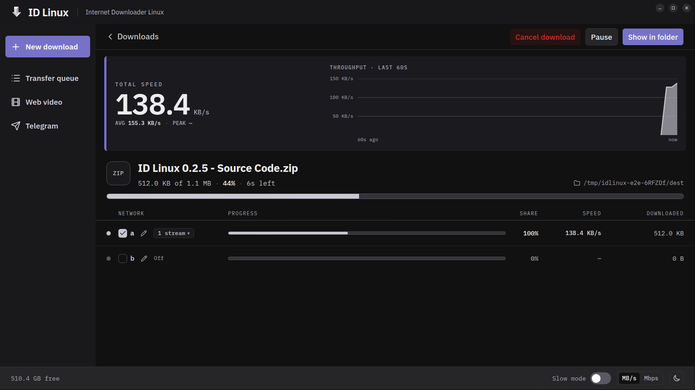

# Internet Downloader Linux

**From browser tab to Linux disk.**

Maintained by Sachin Dot ([@sachindots](https://github.com/sachindots)).

Obsidian / Silver pairs near-black surfaces and a silver folded-arrow logo with IBM Plex Sans and IBM Plex Mono.

ID Linux is an independent IDM-style download manager for Linux. Click a file in your browser, save a video from its player, or paste a link into the app. For large files, you can split a transfer across network interfaces and see what each connection contributes.

[](docs/brand/showcase.mp4)

[Watch the ID Linux source archive download (1080p, MP4)](docs/brand/showcase.mp4) · [View the design carousel](docs/brand/carousel.gif) · [Watch the original desktop recording](docs/brand/desktop-demo.mp4)

Individual slides · [Cover](docs/brand/cover.png) · [Transfer queue](docs/brand/queue.png) · [Browser video capture](docs/brand/video.png) · [Desktop transfer](docs/brand/transfers.png).

## Install

Version **0.2.5** is packaged for **x86-64 Debian and Ubuntu**. From the directory containing the built or downloaded package, run the following command.

```sh
sudo apt install ./idlinux_0.2.5_amd64.deb
```

Open **Internet Downloader Linux** from your applications menu. The package includes the native browser helper, Chromium and Firefox extensions, and a separate video window. APT installs the video dependencies, including Node.js, FFmpeg and GTK 3. A pinned yt-dlp extractor and its JavaScript solver are bundled with the app. For a source checkout, see [Build from source](#build-from-source).

## Connect a browser

Keep ID Linux open for automatic file capture. After loading the extension, grant site access for the pages you want it to handle, reload any existing video tabs, and open the toolbar popup. **Connected** means the extension reached the desktop app.

| Linux desktop browser | How to connect | Verification |
| --- | --- | --- |
| Brave | Open `brave://extensions`, enable **Developer mode**, choose **Load unpacked**, then select the Chromium folder below. | Tested file capture, player-button video downloads and extensionless HLS manifest detection. |
| Firefox | Open `about:debugging#/runtime/this-firefox`, click **Load Temporary Add-on**, then select the Firefox manifest below. Repeat after a restart for this unsigned build. | Tested file capture and player-button video downloads through the native host. |
| Google Chrome, Chromium, Microsoft Edge | Open the browser’s extensions manager, enable **Developer mode** and load the Chromium folder. The package registers the system native host for these browsers. | Packaged for these browsers. Each browser and distribution combination needs local verification. |
| Vivaldi, Opera and other Chromium derivatives | Try the Chromium folder. If the popup cannot connect, the derivative may require a user-level host manifest in its own profile configuration. | Compatibility depends on native messaging and unpacked extension support. |
| Other browsers on Linux | Copy a file or video URL into the desktop app. Browsers that allow external URL handlers can also use the bookmarklet below. | Manual handoff. |

**Chromium extension folder**

```text
/opt/Internet Downloader Linux/resources/extensions/chrome
```

**Firefox manifest**

```text
/opt/Internet Downloader Linux/resources/extensions/firefox/manifest.json
```

## Download a file

1. Click a file download in your connected browser, right-click a link and choose **Download with ID Linux**, or paste its HTTP(S) URL into **New download**.
2. Review the filename, destination and network selection. Click **Download**.
3. Open the transfer to see segment progress and throughput. You can pause it, resume it when the source supports resuming, or update an expired link.

In the extension options, you can turn automatic capture off, exclude a site and its subdomains, or keep files below a chosen size in the browser. When the desktop app is closed, ordinary downloads stay in the browser.

## Download a video

1. Open a page with a visible video. Click **↓ Download with ID Linux** in the top-right corner of the player. Embedded players get their own button. When a custom player exposes only a stream manifest, look in the top-right corner of its frame.
2. If a site has a custom player, open the extension popup. Choose a detected media source, HLS or DASH manifest, or **Find video on this page**. You can also choose **Web video** in the desktop sidebar and paste the page address.
3. Click **Find available qualities**, then choose a resolution, container or audio-only source from **Quality and format**. Video-only sources are paired with audio and merged by FFmpeg. Choose a folder in the video window and click **Download video**. If the site requires sign-in and the extension found matching cookies, you can select **Use my browser session for this video**. This is off by default.
4. Keep the window open until it shows the saved path. Each video window handles one job. Queue scheduling, per-network speed limits and pause/resume apply to the main transfer queue.

The extension recognizes HLS and DASH playlists by their response content type as well as their filename. Reloading the tab clears the detected streams for that page. Direct media, ordinary HTML5 video pages, recorded HLS (`.m3u8`), DASH (`.mpd`) and supported site-specific pages use yt-dlp and FFmpeg. A `blob:` player can work when its page or network requests expose an underlying downloadable stream. DRM-protected playback, live recording, inaccessible browser-only blobs and sites that reject the extractor are outside the supported set. Site compatibility changes as players and authentication change. [yt-dlp supported sites](https://github.com/yt-dlp/yt-dlp/blob/master/supportedsites.md)

To try a small public file, open **Web video** and paste the address of [Mozilla’s CC0 flower video](https://interactive-examples.mdn.mozilla.net/media/cc0-videos/flower.mp4). The packaged video helper was tested against this file byte for byte.

### Send a page without an extension

Create a bookmark named **Save video in ID Linux** and paste this into its URL field. Open a video page, click the bookmark, and allow the browser to open ID Linux.

```javascript
javascript:location.href='idlinux-video://open?url='+encodeURIComponent(location.href)
```

The bookmarklet sends only the page URL. If your browser blocks bookmarklets or external handlers, copy the page address and paste it into **New download → Video link**. These options also work when a sandboxed browser cannot reach the native helper.

## Desktop features

| Source or control | What you can do |
| --- | --- |
| HTTP and HTTPS | Download a direct file, split range-capable transfers across Wi-Fi, Ethernet and other interfaces, and recover supported transfers after restarting. Independent internet paths can add capacity. Interfaces sharing one upstream link also share its capacity. |
| BitTorrent | Open a magnet link or a local `.torrent`, select files and manage trackers. |
| Usenet | Configure a news server and import an NZB to download its articles. |
| Telegram | Configure your Telegram API credentials, sign in and download media from Saved Messages. |
| Queue | Search, filter and select downloads, set concurrent jobs, schedule transfers and inspect history. |
| Networks and bandwidth | View per-interface progress, configure proxies, set speed limits, toggle slow mode and manage daily, weekly or monthly data allowances. |

## Privacy and storage

The extension uses the browser’s native messaging API. Its local helper communicates with the desktop queue over a per-user Unix socket. Site access lets the extension see media on permitted pages. A read-only request listener checks response content types for stream playlists. Download and cookie permissions let it hand off eligible file downloads, including the matching session, referrer and user agent. The video window lets you decide whether to use the offered cookies for that job. Pasting a URL or using the bookmarklet supplies no browser session.

Queue state and preferences live under `${XDG_CONFIG_HOME:-$HOME/.config}/idlinux/`. Completed files go to the folder you select. File transfers create a sibling `.idlinux` partial while running. Video jobs use a private temporary directory inside the destination and choose a numbered filename if the final name is already taken.

## Troubleshooting

| Symptom | What to check |
| --- | --- |
| Extension says **ID Linux not open** | Open the desktop app and refresh the popup. Install the Debian package to register the native host. Check extension site access. For sandboxed browsers, verify that their native-messaging portal can reach the host. |
| A Chromium derivative cannot find the host | The installed manifest is `/etc/chromium/native-messaging-hosts/org.idlinux.manager.json`. If the browser documents a user-level `NativeMessagingHosts` directory, copy the manifest there and restart the browser. Keep the packaged extension identity and helper path intact. |
| No button appears on the player | Check that the installed ID Linux package is 0.2.5 or later with `dpkg-query -W idlinux`. In the browser’s extensions manager, reload the extension, allow access to the site and refresh the video tab. Start playback to reveal streams that the page loads on demand. Browser-internal pages and protected extension-store pages restrict content scripts. |
| Extractor reports 403, an expired URL, or an unsupported site | Reopen the page, pick a fresh source, and enable the session checkbox for a signed-in video. Check the yt-dlp version available to `/usr/bin/python3`. A DRM-only or unsupported source may have no downloadable output. |
| External handoff does nothing | Run `xdg-mime query default x-scheme-handler/idlinux-video`. The installed handler is `org.idlinux.video.desktop`. You can also open **Video link** in the app directly. |

## Project layout

| Directory | Contents |
| --- | --- |
| `src/main`, `src/preload`, `src/renderer` | Electron download engine, desktop bridge, and interface |
| `extension` | Chromium and Firefox browser extension |
| `integration` | Native messaging host, video downloader, and Linux desktop registration |
| `e2e` | Playwright tests for the desktop and browser workflows |
| `docs/brand` | Product screenshots, carousel, and video demo |

## Build from source

Use Linux with Node.js 24, npm 11, Python 3 and the runtime dependencies. Run these commands from the repository root.

```sh
sudo apt install nodejs ffmpeg python3-gi gir1.2-gtk-3.0
npm ci --ignore-scripts
npm run postinstall
npm run build:linux
```

The postinstall step applies the bundled torrent patches and prepares Electron. The build type-checks the desktop app, tests and extension, then writes the Debian package to `dist/`. The unpacked extensions are also available in `extension/dist/chrome/` and `extension/dist/firefox/`. Run `npm run dev` for the desktop development window. To install your locally built package on x86-64, run `sudo apt install ./dist/idlinux_0.2.5_amd64.deb`.

## Verify a build

After building, run these commands from the repository root. The browser check uses an installed Brave executable, a temporary browser profile and a local HTTP origin. The media test generates its own video, serves a cookie-protected HTML page and HLS/DASH manifests, then compares decoded frames.

```sh
npm run lint
/usr/bin/python3 integration/test_video.py
IDLINUX_E2E_SKIP_BUILD=1 xvfb-run -a npm run test:e2e:smoke
IDLINUX_E2E_SKIP_BUILD=1 IDLINUX_TEST_BROWSER=/usr/bin/brave-browser \
  xvfb-run -a npx playwright test e2e/browserCapture.spec.ts
```

Use `npm run test:e2e` for the full Playwright suite. On a Linux desktop with a display, you can omit `xvfb-run -a`.

## License and background

ID Linux is independently maintained Linux software, inspired by the browser-to-desktop workflow of Internet Download Manager for Windows. The repository includes static REA observations about the reference installer. ID Linux modifications are credited to Sachin Dot. The MIT license retains Anmol Kapil’s original copyright notice for the reused desktop code. [License](LICENSE) · [Installer analysis](analysis/IDM.md)

The desktop, extension and artwork use IBM Plex Sans for the interface and IBM Plex Mono for transfer figures. Both are bundled for offline use under the SIL Open Font License. [IBM Plex Sans license](src/renderer/src/assets/fonts/IBMPlexSans-LICENSE.txt) · [IBM Plex Mono license](src/renderer/src/assets/fonts/IBMPlexMono-LICENSE.txt)
